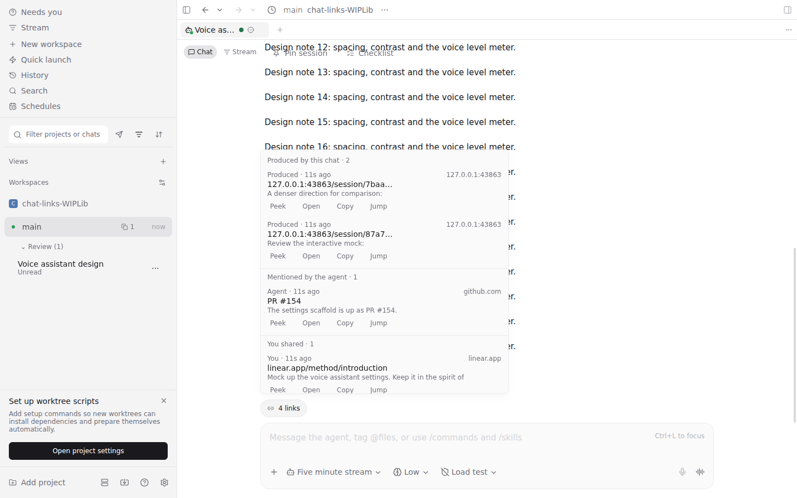
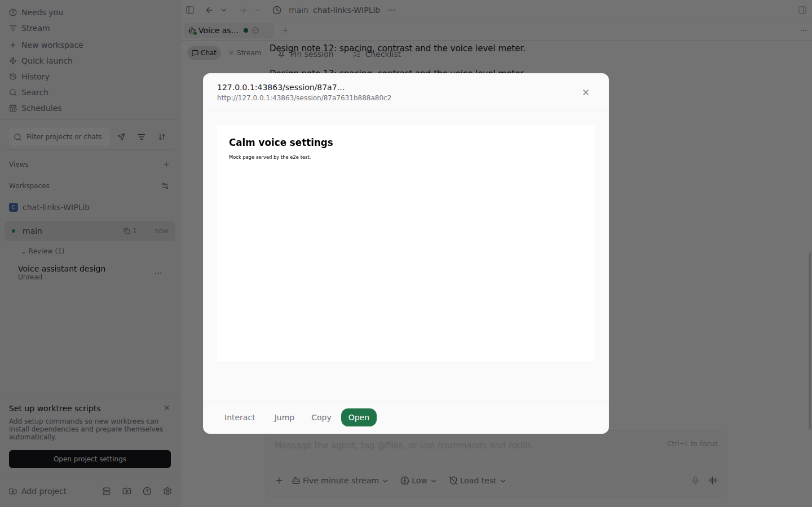
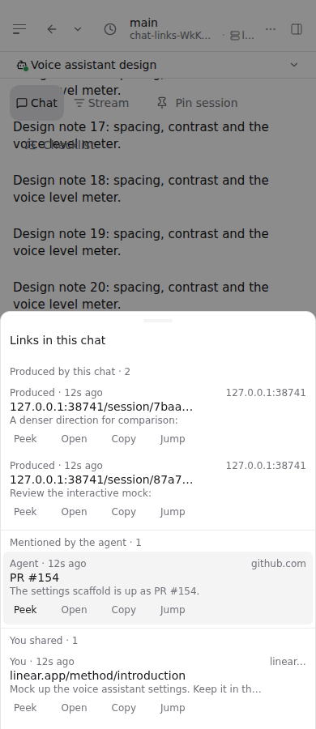
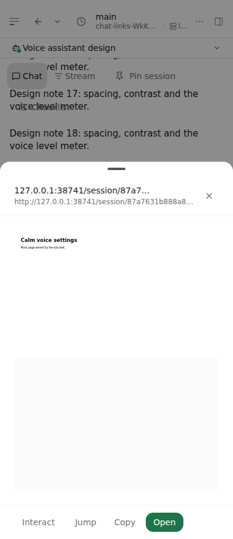
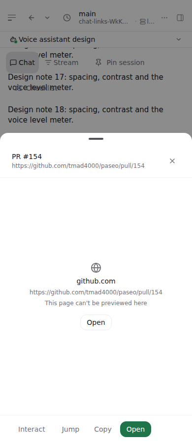
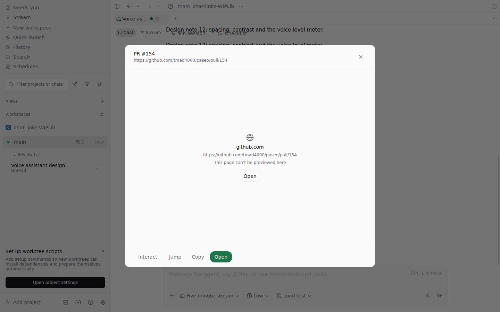

# Chat links

The **Links track** lists every http(s) link in a chat so you can find a mock, an artifact or a
pull request again without scrolling, and **Peek** shows the page without leaving the chat.

## What it lists

A pill in the composer track ("4 links") opens a panel of the chat's links, grouped by where each
one came from and newest first within a group:

| Section                    | Origin     | Typical link                                                   |
| -------------------------- | ---------- | -------------------------------------------------------------- |
| **Produced by this chat**  | `produced` | A Lavish session printed by `lavish-axi`, a `gh pr create` URL |
| **Mentioned by the agent** | `agent`    | A link the agent wrote in prose                                |
| **You shared**             | `you`      | A URL you pasted                                               |

Section headers are hidden when only one section has rows. Each row shows the markdown label (or a
shortened host and path), the line it appeared in, the host, and **Peek**, **Open**, **Copy** and
**Jump**. Tapping the row peeks it.

**Origin is decided by the first occurrence.** A URL first printed inside a tool result is
`produced` even when the agent quotes it afterwards. The row's context line and its Jump target
come from the first prose mention when there is one ("Review the interactive mock:" reads better
than the terminal line), else from the first occurrence.

Sources, in row order: user messages, assistant messages, and tool results — shell command and
output, `fetch` URL, `plain_text`, `sub_agent` log, and `unknown` output. Reasoning rows and file
bodies (`read`, `edit`, `write`) are skipped. URLs inside CSS `url(...)` or a data URI are markup,
not links. The extractor is `packages/app/src/chat-links/model.ts`; it scans each row once (rows
are immutable), so the count stays live while the agent streams.

## Completeness

The list is derived on the client from the timeline rows it holds. There is no daemon index and
no protocol change. When earlier history is not loaded, the panel says **Earlier messages not
loaded** and offers **Load earlier**, which runs the same history-start pagination as the
transcript. It does not claim completeness it cannot see.

## Peek

Peek opens a card over the chat on wide screens and a sheet on compact ones
(`AdaptiveModalSheet`). Opening a peek closes the links panel; reopen the pill to peek another.

- **Desktop and web:** a sandboxed iframe laid out at 1280 × 800 and scaled with `transform` to
  fit, so the page looks like its desktop self. Pointer events are off for a static peek;
  **Interact** shows it at real size with scrolling and input.
- **Native:** a WebView in the sheet, with the page's viewport set to 1280 wide and scaled to fit.
- **Fallback card:** host, full URL, "This page can't be previewed here", and **Open**. It shows
  when the frame has not loaded after 6 s, at once for hosts known to refuse framing (GitHub,
  Google, X, LinkedIn and others in `peek-model.ts`) because a refused frame still fires `load`,
  and for pages on the app's own origin, which a scripted same-origin frame could escape.

Lavish sessions send no `X-Frame-Options` or `frame-ancestors`, so mocks preview. Tailnet-only
URLs preview on clients that are on the tailnet; the fallback covers the rest.

## Open and Jump

| Platform          | Open                                                                                                                                                                                                                              |
| ----------------- | --------------------------------------------------------------------------------------------------------------------------------------------------------------------------------------------------------------------------------- |
| Desktop app       | Browser tab in the workspace's side pane — the `ui.tab.open` browser target with `placement: "side"`, applied on this client ([agent tab control](agent-tab-control.md#side-placement-page-targets-and-delivery-fork-2026-10-10)) |
| Web, iOS, Android | System browser (`openExternalUrl`); browser panes are desktop-only                                                                                                                                                                |

Jump scrolls the chat to the row that holds the link, revealing older loaded history first if the
transcript window has not mounted it. It is disabled when that row is no longer loaded.

Provider subagent panes get the track too; it has no write actions.

## Evidence

`packages/app/e2e/browser/chat-links.spec.ts` seeds a chat shaped like the voice-assistant design
chat that prompted the feature (`packages/app/src/chat-links/fixture.ts`): two Lavish mocks first
printed by Bash, a PR in assistant prose, and a pasted reference. It checks the count, grouping,
an iframe peek of a locally served page, Interact, the fallback card for GitHub, and Jump.

| Width  | Panel                               | Peek                                     | Fallback                                     |
| ------ | ----------------------------------- | ---------------------------------------- | -------------------------------------------- |
| 390px  |   |   |   |
| 1440px |  |  |  |

## Not yet

- A daemon-side link index (`agent.links.list`, gated by `features.chatLinks`) so links survive
  history windowing and reach MCP and the global Stream.
- Page titles fetched by the daemon.
- Links as a Stream card kind, and pinning a link to Stream from its row.
- Hover peek on in-chat links (desktop web).
