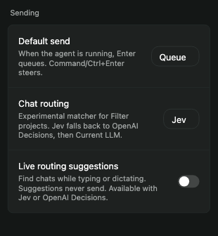
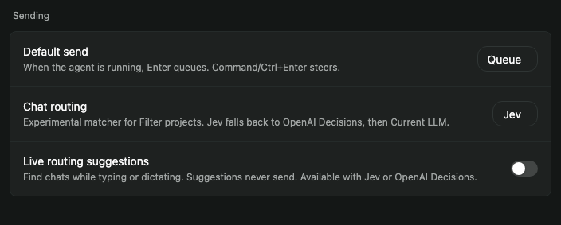
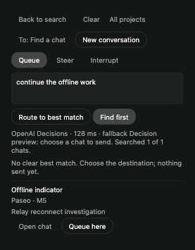

# Decision routing experiment — pspin-ng3

Prepared 2026-10-26 on M4 from `c3bf1926b`, branch `feat/live-routing-pspin-ng3`.
Source and isolated tests only; the installed desktop/phone/daemon have not changed.

## Behavior and visual checks

Uses the existing settings card/select/switch primitives, theme, typography and spacing.
The task is choosing a destination chat from Filter projects, with a small optional provider
setting and immediate lexical results followed by debounced semantic suggestions. The source
defaults to OpenAI Decisions for the October 27 trial and keeps live suggestions opt-in. No new layout system or dependency was introduced.

Browser tests cover live-search debounce without delivery, provider request forwarding, fallback
labels, explicit destination selection despite a high decision probability, old-host capability
handling, and the existing queue/draft/stale-response behavior. Settings storage tests verify
missing provider selections use OpenAI Decisions, saved choices survive, and live suggestions stay off.

Desktop/phone-width screenshots were inspected for readable copy, unclipped selectors and normal
existing control geometry. The screenshot harness renders real controls with static animation
hooks; it does not establish native animation or device acceptance.

## Commands and raw results

- `npm run build:server`: passed after applying the repository's postinstall patches.
- `npm run typecheck`: passed across workspaces. [Raw output](decision-routing/typecheck.txt).
- `npm run lint`: passed. [Raw output](decision-routing/lint.txt).
- `npm run format`: passed.
- Server: `npx vitest run src/server/session-decision-routing.test.ts src/server/session-search.test.ts --bail=1` — 25 tests passed. [Raw output](decision-routing/server-tests.txt).
- Session: `npx vitest run src/server/session.test.ts -t 'session Find' --bail=1` — 2 tests passed, 150 unrelated tests skipped. [Raw output](decision-routing/session-tests.txt).
- App: `npx vitest run src/hooks/use-settings/storage.test.ts src/components/sidebar/session-routing/composer.browser.test.tsx --bail=1` — 138 tests passed, no unhandled errors. [Raw output](decision-routing/app-tests.txt).

The adapter tests check official request formats, strict option/distribution validation, Jev →
OpenAI fallback, unavailable credentials → existing matcher, valid no-match, response-size limits,
request deadline, and cancellation without fallback. Requests use only synthetic credentials in
these deterministic tests.

## Live API smoke

Using an existing local OpenAI key without printing it, a Jev-selected request with no Jev key
fell back to the real OpenAI Decisions API. An initial two-candidate example matched correctly in
893 ms. A subsequent five-question, eight-candidate run matched all five expected synthetic
chats in **375, 319, 190, 298 and 357 ms** (median 319 ms).
[Full non-secret synthetic receipt](decision-routing/openai-smoke.json).

These measure only the adapter's live fallback call. They exclude full-daemon directory/history
reads, network transit from the phone, and the 450 ms UI debounce. They are smoke tests, not
accuracy calibration or a benchmark of Jacob's real chat collection. No prompts were delivered
to real agents. Jev's live service remains untested because no TypeSafe key was available.

## Platform and rollout limits

Web Chromium: browser assertions and desktop/phone-width visual inspection passed.
Native iOS/Android and packaged Electron: typechecked, not installed or device-tested.
Old-host fixture keeps Current LLM/manual selection while explaining the unavailable decision
option. New wire fields are optional, so old clients still parse new responses and current
clients omit the provider on the Current LLM path. The installed fork requires a normal coordinated
client/host release to expose this experiment; no shared daemon restart was performed.

Before enabling decision auto-send, evaluate destination accuracy and thresholds on labeled
realistic cases. During this experiment, a decision probability never bypasses the destination
choice. Current LLM's existing explicit route action retains its established thresholds.

## October 27 provider selection

Jacob selected OpenAI Decisions while setting up TypeSafe. The trial now defaults to OpenAI
Decisions when no provider is saved; an explicit saved choice is retained. The existing LLM
remains the final fallback. PR #125 initially passed all 13 applicable CI checks (6 skipped).
This source selection does not configure credentials or activate the installed client/daemon.
