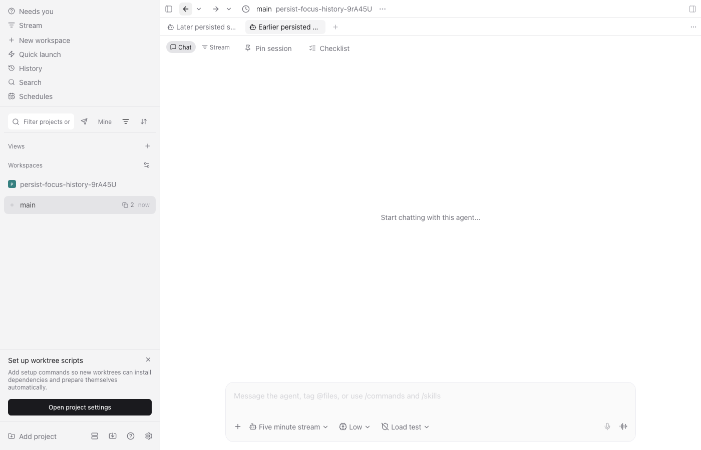

# Restart history — pspin-yud

Source fix: `236596c18636452fe0f51576ebd0935641a16118`. This is source verification, not an installed-build receipt.

Back/Forward previously lived only in memory. The fix saves the two bounded stacks and confirmed current focus through AsyncStorage, and hydrates before startup observations can overwrite them.

## Behavior exercised

On macOS arm64 with the real web client and an isolated daemon, open two disposable sessions, visit both, and go Back to the earlier one. Reload the renderer and go Forward to the later session. Navigate through the root cold-start route and go Back to the earlier session again. Both selected-tab assertions passed. The harness stopped its daemon and Metro afterward.



```text
npm run test --workspace=@getpaseo/app -- src/navigation/focus-history-persistence.test.ts src/navigation/focus-history.test.ts src/navigation/focus-history-runtime.test.ts --project unit --maxWorkers 1 --bail=1
Test Files  3 passed (3)
Tests       38 passed (38)
```

The persistence cases cover cold recreation and direction ordering, delayed hydration, restored view defaults, interruption before a history jump lands, closed empty-tab removal, reset, invalid/version-mismatched storage, bounds, serialized writes, and storage failures. Existing focus and restore tests cover ordinary navigation and unavailable targets.

```text
npm run test:e2e --workspace=@getpaseo/app -- e2e/browser/navigation-history-dropdown.spec.ts --grep 'Back and Forward survive renderer reload and cold startup' --workers=1
1 [browser] Back and Forward survive renderer reload and cold startup (29.9s)
[e2e] Worker 0 daemon stopped
[e2e] Metro stopped
1 passed (3.1m)
```

The initial focused regression failed before hydration existed. The production model's previous memory-only lifetime explains the restart loss; an old-build browser run was not performed.

Full workspace `npm run typecheck`, targeted `npm run lint`, and `npm run format:check:files` passed. The November 9 source commit hooks repeated format, lint and the full workspace typecheck successfully. Dependencies stayed pinned to the lockfile. Browser verification used an isolated Mac checkout; no installed app, live daemon or updater policy changed.

## Platform coverage

| Platform               | Coverage                                                       |
| ---------------------- | -------------------------------------------------------------- |
| Browser web on macOS   | Real reload/cold-start regression and screenshot above         |
| iOS                    | Shared persistence model tests; native app restart not checked |
| Android                | Shared persistence model tests; native app restart not checked |
| Packaged macOS desktop | Not checked                                                    |
| Windows desktop        | Not checked                                                    |
| Linux desktop          | Not checked                                                    |

The release owner still owns packaged-platform acceptance and source inclusion. This PR does not cut a release or change any staged artifact.
