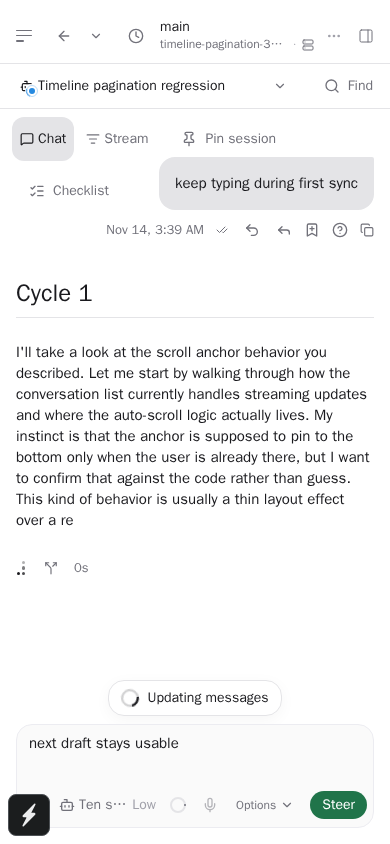

# Message-update responsiveness — pspin-bvs

Known chats keep their composer available during first history sync. Send releases the composer
after the device saves the complete message, while ordered host delivery continues in the background.
The passive sync badge sits inside the history area above the composer; user errors take priority,
and toast actions remain inside their native parent bounds for Android hit testing.

## Source validation

The initial implementation and UI repairs at `c8ef9cda1` passed full workspace typecheck, lint,
formatting, 248 focused app tests, four tooltip browser component tests, and 12 selected
daemon-backed browser scenarios across runs. GitHub CI also passed on that revision. That CI run
does not validate the later delivery-coordination repairs.

The delivery repairs were checked on GCP `jacob-dev-1` using Node 22.23.3. The exact source revisions,
commands, exit codes and logs are retained in the task's validation receipts. Builds, full workspace and app typechecks, lint, formatting, focused unit/component tests and
daemon-backed browser flows were run there. Revision-specific commands and outcomes for the
published source are listed in the PR; earlier diagnostics are retained rather than counted as passes.

The published revision's required checks are recorded on [PR 207](https://github.com/tmad4000/paseo/pull/207).

The phone-width flow holds actual daemon WebSocket responses for first history and Send, submits
through the real composer, types a second draft before releasing either response, and verifies that
draft survives. Recovery cases exercise definite refusal, identical-ID/image-payload retry,
reconnect and status continuity. Other cases hold a direct request before host dispatch, save a
later queue message locally, then verify canonical delivery order. Routed Queue, ambiguous
one-shot recovery through reload, Send Back and reopening the original thread are covered too.

The history-layout test first verifies that its response text and read tool are absent from the
seeded history, then checks that both appear after Send. It retains the original row-stability
recorder. A total mounted-row count is unsuitable for virtualized
history: a new row can replace an older mounted row without increasing the count. Earlier
diagnostic failures and traces are retained; the assertions for a missing row and downward movement
were preserved.

## Review repairs

Independent review caught gaps in the first implementation:

- Refusal settlement now runs for composer delivery, reconnect and manual Retry, preserving the
  newer draft and the identical saved message identity and payload.
- Tooltip timing includes the actual child action and avoids nested double-counting. Sidebar
  Enter/Space actions preserve navigation isolation. Sync status preserves error priority and
  alert identity, and its native touch targets stay within parent bounds.
- One per-agent worker orders direct sends, queued messages, routing, Send Back and Stream replies.
  Creation order accounts for hydrated entries even after a backward device-clock change.
  Other chats and local cancellation can proceed independently.
- Unknown outcomes retain ownership across restart and slow or failed storage writes. One-shot
  routed sends have an explicit recovery hold and are never automatically replayed. The receipt
  owner normalizes the first ambiguous provider response and completion-write failures; the
  client also recognizes older daemon wording. Known pre-submission refusals remain distinct.
- Failed provisional saves and terminal routing preparation failures wake later saved work.
  A preparation wake-up runs only after its own entry is durably removed; retained failures do
  not trigger an implicit retry. Recovery releases ordering ownership only after persistence succeeds.
- Broadcast results distinguish device-pending saves from confirmed host delivery.
- Delivery hydration and flushing use dependencies available when the composer loads, keeping
  lazy code-bundle fetches off the first-send path.

The executable regressions use real store operations and held/failing storage to check ordering,
restart recovery, exclusion, cancellation, independent agents and automatic wake-ups. Dependency
compilation occurs in module setup outside timed storage assertions; cold module resets,
hydration scenarios and behavioral timeouts remain intact. Tests execute behavior rather than
checking implementation source strings.

## Performance evidence and limits

One synthetic run queues 1,024 assistant deltas for each of eight chats. Both implementations
produce identical final text. This isolates reducer/commit scheduling and excludes React rendering,
native touch dispatch and screen presentation; it is not an iPhone benchmark or a CI threshold.

| Node 22, 8,192 queued events |  Before |   After |
| ---------------------------- | ------: | ------: |
| Scheduled callbacks          |       1 |      64 |
| Longest callback             | 26.84ms |  4.81ms |
| p95 callback                 | 26.84ms |  0.56ms |
| Total reducer/commit time    | 26.84ms | 24.23ms |

The optional developer-web stream-smoothness experiment did **not** consistently meet its strict
12ms React p95 budget. Three baseline samples were 12.5/13.0/12.0ms; three interim patched samples
were 15.1/12.6/14.4ms. All six visible-update-gap p95 measurements were below the separate 250ms
budget. Workload phase and characters painted differed, so this is not a controlled release/native
comparison and does not establish either an iPhone improvement or a rendering regression. The
budget was not relaxed. Physical-device release profiling remains necessary.

Responsiveness diagnostics measure synchronous handlers, the next JS animation-frame callback,
event-loop stalls and reducer batches. They are bounded and contain no message text, route or
control labels. These measurements do not include native pre-JS input queuing, confirmed screen
presentation or asynchronous action completion. See [telemetry coverage](../agent-stream-performance.md#responsiveness-telemetry).

## Platform coverage

| Platform    | Coverage                                                                                                |
| ----------- | ------------------------------------------------------------------------------------------------------- |
| Browser web | Unit/component and daemon-backed flows; 390px layout visually inspected                                 |
| iOS         | Initial implementation's native JS export passed; optimized bytecode, signing and device checks pending |
| Android     | Shared behavior and native parent bounds reviewed; device verification pending                          |
| Electron    | Shared source checks and required PR CI; installed application not verified                             |

The optional Linux iOS export used Expo `--platform ios --no-bytecode --max-workers 2` with an
8 GiB Node heap. Optimized Hermes compilation exceeded that builder's memory budget, including a
standalone compile capped at 27 GiB virtual memory. This is build-time allocation, not phone memory.
An installable iOS build requires Apple tooling and signing, whether on a local or cloud Mac.

The user selected code and CI only. No app distribution, installation, signing changes or shared
daemon restart is included.
