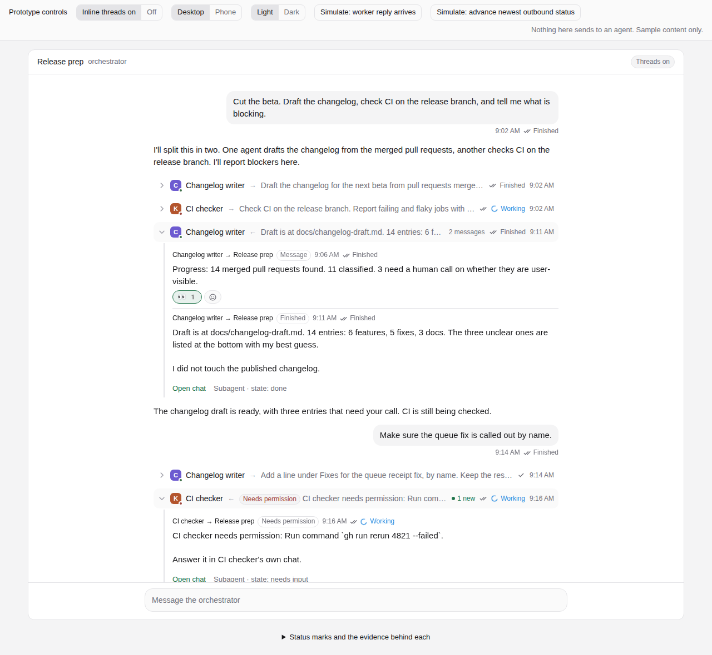
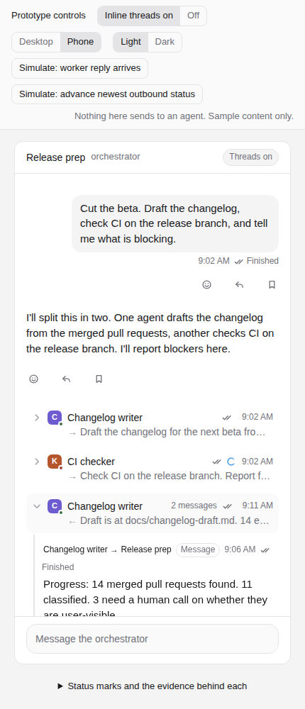
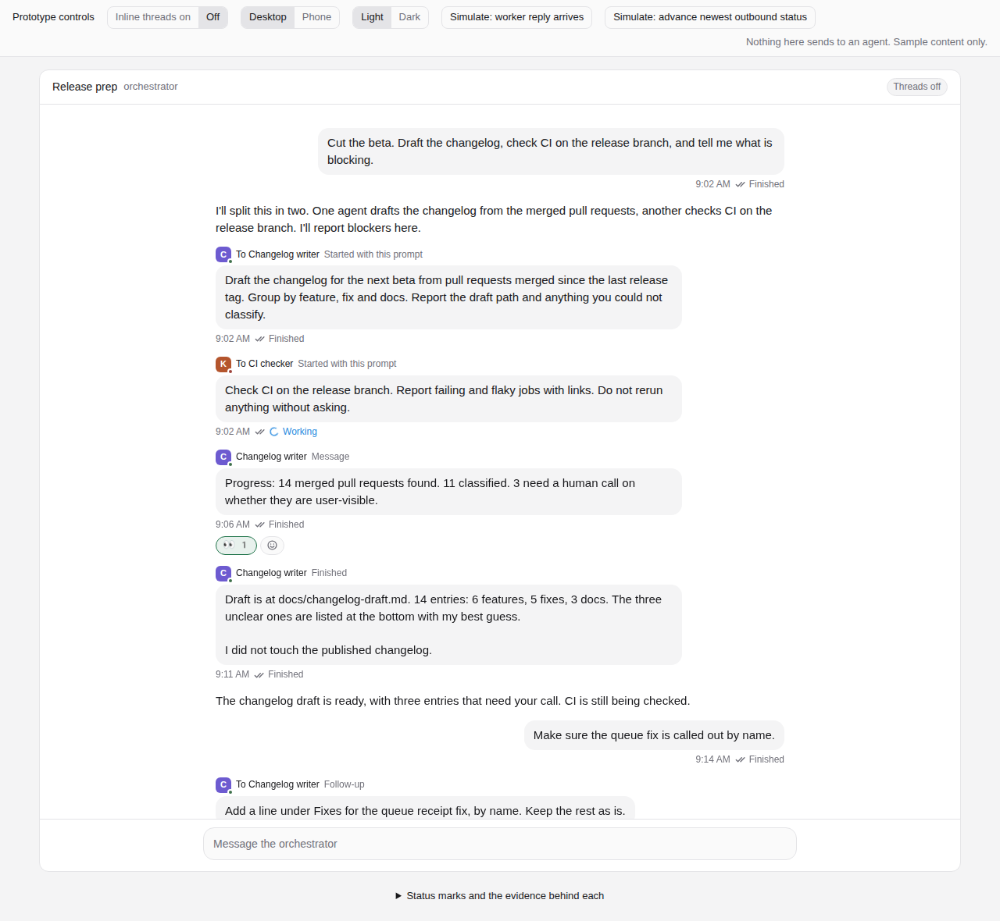

# Paseo fork: inline threads, message statuses and reactions — design and spec

Date: 2026-11-14. Author: product and technical design pass for Jacob's fork `tmad4000/paseo`.
Inputs: Jacob's request of 2026-11-14 (section 2); the recovered plans listed in
[inline-threads.md](inline-threads.md#history); fork `main` at `9ae1aafe2` (code identical to
`accd8743a`; the commits between are docs only). All `path:line` references are at that commit.
An independent review checked the references and technical claims against the source; its
corrections are folded in (section 13 lists what stays unverified).

This is a design, with an [interactive prototype](inline-threads/prototype.html). Phase 0 is
implemented in a separate PR. Nothing else here is built.

---

## 1. Recommendation

Build one row primitive, the **thread row**, and use it wherever a chat shows a message
exchanged with another agent. Keep rows where they happened in time, collapsed to one line.
Reuse what exists for everything else:

| Need                              | Reuse                                                                                      | Add                                                                                           |
| --------------------------------- | ------------------------------------------------------------------------------------------ | --------------------------------------------------------------------------------------------- |
| Know who sent a message           | The sender vocabulary (`human`, `schedule`, `agent:<id>`) and the three places that set it | Record it for CLI sends made by an agent (Phase 0). Keep it somewhere that survives a restart |
| A durable record of the exchange  | Store rules of the daemon queue; the ids the queue and receipts already use                | The **exchange log**: one small per-agent file of agent-to-agent messages, in and out         |
| Read and reply to the other agent | Subagents drawer                                                                           | Nothing                                                                                       |
| Delivery marks                    | Clock, check, double check, alert from `composer/delivery-state.ts`, unchanged             | A separate turn state (Working, Finished, Stopped, failed) from turn events                   |
| Reactions                         | Message action row; message ids                                                            | A small host store and three RPCs. No reaction model exists today                             |
| Default on, can be turned off     | `AppSettings` boolean with `.catch(true)`, Settings → Chat                                 | One setting                                                                                   |

Ship it in five phases (section 10). Phase 0 (CLI sender) and Phase 1 (exchange log, thread
rows, the setting) together fix the main problem in an orchestrator chat today: reports from
workers arrive as plain user bubbles that look like Jacob's own messages, and finish
notifications mostly do not appear at all.



## 2. What was asked, and what is proposed

Jacob's ask, 2026-11-14, in his words where it matters: a "Slack style collapsible thread mode"
for orchestrator sessions, "planned for a while", so that "the replies can be mostly in line". It
"should be default on" and "could be disabled". He also wants "statuses on every message I sent
out at least and probably any one received", or at least "reaction emojis kind of like Slack".

| Requested                                                                    | Where it is specified |
| ---------------------------------------------------------------------------- | --------------------- |
| Slack-style collapsible threads in orchestrator chats, replies mostly inline | Section 5             |
| On by default, can be turned off                                             | Section 5.8           |
| A status on every message Jacob sends                                        | Section 6             |
| Probably a status on messages received                                       | Section 6.2           |
| Slack-style emoji reactions, add and remove                                  | Section 7             |

Everything else is a proposal:

- Thread rows stay in time order instead of moving under the first message (section 5.3).
- A thread is defined by recorded sender and recipient, not by parentage (section 5.1).
- The orchestrator's own replies to Jacob are never folded (section 5.3).
- A chat's own driver (the agent that created it) is never folded (section 5.1).
- Delivery and turn state are two separate facts. "Finished" means the turn ended and nothing
  more (section 6.1).
- No read receipts of any kind (section 6.5).
- Reactions are not delivered to agents, and agents cannot read them (section 7.3).
- The CLI sender fix (Phase 0) and the exchange log (Phase 1).

## 3. What exists today

| Capability                          | State at `9ae1aafe2`                                                                                                                                                                                                                                                                                                                                                                                                                                                                                              |
| ----------------------------------- | ----------------------------------------------------------------------------------------------------------------------------------------------------------------------------------------------------------------------------------------------------------------------------------------------------------------------------------------------------------------------------------------------------------------------------------------------------------------------------------------------------------------- |
| Sender on messages                  | `UserMessageSender` (`packages/protocol/src/user-message-sender.ts:9`); `sender` on the `user_message` item (`packages/protocol/src/messages.ts:696-702`). Set for app sends, schedules, MCP `send_agent_prompt` and finish notifications                                                                                                                                                                                                                                                                         |
| Sender in the app                   | **Dropped.** `UserMessageItem` has no sender (`packages/app/src/types/stream.ts:92-103`); the reducer omits it (`:1504-1515`). No bubble says who sent it                                                                                                                                                                                                                                                                                                                                                         |
| Sender for CLI sends                | **Always `human`.** `send_agent_message_request` hardcodes `HUMAN_SENDER` (`packages/server/src/server/session.ts:9298`, `:9326`). `paseo run` resolves the calling agent (`packages/cli/src/commands/agent/run.ts:768`); `paseo send` does not (`send.ts:195`)                                                                                                                                                                                                                                                   |
| Timeline durability                 | **Runtime memory.** Rows are rebuilt from provider history on resume and restart ([architecture](../architecture.md)); provider history carries no sender ([agent lifecycle](../agent-lifecycle.md#who-sent-it)). The epoch is a fresh UUID per store (`packages/server/src/server/agent/agent-timeline-store.ts:49`), so cursors do not survive either                                                                                                                                                           |
| Finish and permission notifications | Sent to the parent from `agent:<child>`, body wrapped in `<paseo-system>` (`packages/server/src/server/agent/agent-prompt.ts:295`, `:508`). **Mostly invisible:** an idle parent is steered with no message id and no row is recorded (`:611-620`); the provider's echo of an envelope is dropped live and on replay (`agent-manager.ts:772`, `:4485`, `:4554`, `:4923`). Only a busy parent, reached through the queue (`agent-prompt.ts:601-608`), gets a row, shown as a raw user bubble until the next reload |
| Tool calls that message agents      | `create_agent`, `send_agent_prompt` (`packages/server/src/server/agent/tools/paseo-tools.ts:1518`, `:1984`) render as generic tool rows. At the default detail level they are grouped with their neighbours; in Quiet they are hidden. Their detail is provider-shaped and carries no reliable recipient field                                                                                                                                                                                                    |
| Reply in thread                     | Side session labelled `paseo.thread-parent` / `paseo.thread-anchor`; **N replies** chip (`packages/app/src/threads/model.ts:9-10`, `turn-controls.tsx:118`). See [threaded replies](../threaded-replies.md)                                                                                                                                                                                                                                                                                                       |
| Subagents drawer                    | A parent's subagents beside its chat, with state, condensed activity and **Reply to {subagent}** (`packages/app/src/subthreads/`). See [agent lifecycle](../agent-lifecycle.md#the-subagents-drawer)                                                                                                                                                                                                                                                                                                              |
| Delivery marks                      | `pending`, `accepted`, `delivered`, `attention` (`packages/app/src/composer/delivery-state.ts:16`), drawn by `components/delivery-mark.tsx:50` on the user's own bubbles and queued rows. See [queue mirroring](../queue-mirroring.md#delivery-marks)                                                                                                                                                                                                                                                             |
| Durable sends                       | Send outbox and queue outbox on the device; receipts (`pending`, `completed`, `removed`) and queue `drainedLog` on the host (`packages/server/src/server/message-receipts/index.ts:9`, `agent-queue/store.ts:36`). A queued item keeps its sender to delivery                                                                                                                                                                                                                                                     |
| Delivery inspection                 | `agent.queue.inspect` and `paseo queue ls` ([queue mirroring](../queue-mirroring.md#delivery-inspection))                                                                                                                                                                                                                                                                                                                                                                                                         |
| Turn lifecycle                      | `turn_started`, `turn_completed`, `turn_failed`, `turn_canceled` on the live stream (`packages/protocol/src/messages.ts:749-768`). The app keeps only the one open turn per agent; finished turns leave no record, and a timeline fetch returns items only                                                                                                                                                                                                                                                        |
| Collapsing in the stream            | Tool-call groups (`packages/app/src/tool-calls/detail-level/grouping.ts:134`), long prompts (`components/collapsible-prompt.tsx:8`), reasoning. Find reveals clamped text (`chat-find/index.web.tsx:52`)                                                                                                                                                                                                                                                                                                          |
| Message actions                     | Reply, Save to Stream, Copy, Fork, Reply in thread (`packages/app/src/components/message.tsx:701-732`, `:791-882`)                                                                                                                                                                                                                                                                                                                                                                                                |
| Unread                              | Per agent, on the host (`requiresAttention`), plus per-device read and seen clocks (`packages/app/src/stores/agent-read-marks-store.ts:15-17`). Nothing per message                                                                                                                                                                                                                                                                                                                                               |
| Preferences                         | Per device, `AppSettings` in AsyncStorage. Default-on pattern: `chatOutlineEnabled` (`packages/app/src/hooks/use-settings/storage.ts:92`, `:155`, `:254`). No host-synced preferences                                                                                                                                                                                                                                                                                                                             |
| Reactions, mentions                 | None. No model, RPC, UI or feature flag                                                                                                                                                                                                                                                                                                                                                                                                                                                                           |

Four facts shape the design:

1. **Orchestrators that use the CLI lose attribution.** An agent that runs `paseo send` is
   recorded as `human`. Every worker report in such a chat is stored and drawn as the user's.
2. **The timeline cannot be the record.** It is runtime memory. After a restart it is rebuilt
   from provider history, with no sender, no turn ids and a new epoch. A design that reads
   `sender` off timeline rows works until the daemon restarts and then forgets who said what.
3. **Finish notifications are hidden on purpose.** The envelope is kept out of the transcript,
   so most of them never appear in the parent's chat. The parent starts a turn with no visible
   cause.
4. **The timeline item union is closed** (`packages/protocol/src/messages.ts:694`). A new item
   type would fail to parse on older clients, so anything new rides beside the timeline, behind
   a feature flag.

Together these mean the durable record has to be new and has to sit beside the timeline. It
is small: section 8.2.

## 4. Vocabulary

- **Thread row** — one collapsed line in a chat standing for one or more adjacent messages
  exchanged with one other agent. UI copy never needs the term; code and docs do.
- **Counterpart** — the other agent in a thread row.
- **Exchange log** — the daemon's durable per-agent list of agent-to-agent messages, in and
  out. Thread rows are drawn from it.
- **Driver** — the agent that created a chat (`createdBy = agent:<id>`), or its parent. Its
  prompts are that chat's main input and are never folded.
- **Open chat** — the action on a thread row that shows the counterpart's full chat beside this
  one. ("Open thread" is taken by Reply in thread.)
- **Thread** (existing) — a Reply-in-thread side session. Unchanged. Section 5.9 says how the
  two meet.
- **Delivery** and **turn state** — the two status facts of section 6.
- **Reaction** — an emoji a person attaches to a message. Never a status.

## 5. Inline threads

### 5.1 What goes in a thread row

An entry of the chat's exchange log. The daemon writes an entry at the four places where it
already knows both ends of a message:

| Route                                          | Recorded by                                   | In the recipient's log | In the sender's log |
| ---------------------------------------------- | --------------------------------------------- | ---------------------- | ------------------- |
| MCP `send_agent_prompt`                        | The tool handler, which sets `sender` today   | Inbound                | Outbound            |
| Agent-scoped `create_agent` (initial prompt)   | The create path, which sets `createdBy` today | Inbound                | Outbound            |
| Finish, error, permission, closed notification | `setupFinishNotification`, with its reason    | Inbound                | Outbound            |
| `paseo send` from an agent's shell (Phase 0)   | The send handler, from `callerAgentId`        | Inbound                | Outbound            |

Nothing else makes a thread row. No inference from message text, id shape, timing or shell
command strings. The notification kind comes from the reason the daemon used when it built
the notification, not from parsing the envelope.

Rules:

- **Membership follows the message, not parentage.** A detached worker or a sibling forms a
  thread row the same way a subagent does. This answers the first open question on `pspin-plx`
  (section 12).
- **The driver is not folded.** In a worker's chat every prompt comes from its parent. Those
  are the chat's main input and render as prompts, headed "From {parent}". Thread rows are for
  every other agent.
- **A message whose sender was not recorded renders as it does today.** Messages from before
  the exchange log existed are not regrouped; nothing recorded who sent them.
- Schedule and heartbeat prompts are out of scope. They are not exchanges with an agent.

### 5.2 The collapsed row

One line on desktop, two on a phone:

```
▸ [C•] Changelog writer  ←  Draft is at docs/changelog-draft.md. 14 entries…   2 messages  ✓✓ Finished  9:11 AM
```

Left to right:

1. Chevron. The whole row is one button.
2. Counterpart, drawn the way sidebar session rows draw an agent: provider icon with the live
   status dot (`getStatusDotColor`), then the title in `foreground`. The prototype's lettered
   squares stand in for provider icons.
3. Direction of the newest message in the row: `←` from the counterpart, `→` to it. Screen
   readers hear "From" or "To".
4. One-line preview of the newest message, `foregroundMuted`. A notification previews the
   agent's response text.
5. Message count when the row holds more than one.
6. **N new** in accent when the row holds inbound messages this device has not seen (5.6).
7. The newest message's delivery mark and turn state (section 6), then its time.

A row that carries a permission notification or a failed turn shows a `StatusBadge` ("Needs
permission", "Failed") before the preview, in the status token on the neutral shell
([design, status pills](../design.md#13-status-pills-and-badges)). It stays collapsed. Nothing
expands on its own.

The row's height is fixed. A status change, a count change or a new preview never moves the
rows around it ([design, states](../design.md#11-states)).

### 5.3 Where rows sit

**In time order.** Each exchange-log entry is placed in the transcript at one of two positions:

- When the current timeline holds the message's own row (a plain prompt that arrived through
  the queue or a send with a message id), the thread row takes that row's place.
- Otherwise (a notification, which has no row; an outbound message, which lives in the other
  chat; a message still waiting in the queue), it is placed by its recorded time among the
  timeline's rows.

Adjacent thread rows with the same counterpart merge into one. Any other item between them (a
user message, assistant text, a tool call, reasoning) ends the row, so nothing is reordered. A
later exchange with the same counterpart is a new thread row lower down.

This differs from Slack, where replies collect under the first message. The reasons:

- An agent's timeline is linear and its turns are caused by what arrived before them. Moving a
  worker's report up the page would leave the orchestrator's next turn with no visible cause.
  Placing notifications by time does the opposite: it shows the cause that is hidden today.
- New activity lands at the bottom, where the reader is and where follow-bottom scrolling
  already works.
- The transcript order stays the transcript order. Turning the setting off shows the same
  messages in the same places.

The orchestrator's own assistant text is never folded, including turns that a worker's message
triggered. That text is addressed to the user.

Tool-call rows are left alone. The `send_agent_prompt` call that sent a message keeps its
place in its tool group, and the outbound thread row sits after it. The tool row is the
mechanism; the thread row is the message. In Quiet mode the tool rows are hidden and the
thread rows remain.

The whole exchange with one agent, in one place, is the counterpart's own chat. **Open chat**
shows it in the subagents drawer.

### 5.4 The expanded row

Expanding shows the row's messages in order under a left rail, indented one step. Each message
shows:

- **Route**: `Changelog writer → Release prep` or `Release prep → Changelog writer`, by title.
  Hover or long-press shows short ids.
- **Kind**, from the log entry: "Started with this prompt" (`create`), "Follow-up"
  (`prompt`), "Message" (`cli`), and for notifications "Finished", "Errored", "Needs
  permission", "Was closed" (the four reasons at `agent-prompt.ts:496`).
- Time, the delivery mark and the turn state, with their labels.
- The message text as Markdown. The log holds up to 4,000 characters, the bound finish
  notifications already use. A longer message ends with "Open chat for the full message".
  Long text uses the existing Show more / Show less (`collapsible-prompt.tsx`).
- The same actions as any message: Add reaction, Reply (quote), Save to Stream, Copy.
- Reaction chips.

The footer has **Open chat** and the counterpart's relationship and state ("Subagent ·
working", "Agent · idle").

A permission notification says where to answer it and links there. It never offers Approve
inline: approvals stay in the subagent's own stream, as the drawer already requires.

There is no composer inside a thread row. Replying to the counterpart happens in the drawer,
whose composer is already named **Reply to {subagent}**. One composer takes input at a time;
that rule from the drawer stands.

### 5.5 Sender, recipient and owner cues

- The user's own messages keep their bubble, on the right.
- A message the exchange log attributes to an agent is never drawn as the user's bubble, with
  the setting on or off. With threads off it is a left-aligned block headed by the agent's
  icon, title and kind.
- A driver's prompt in a worker chat is a prompt block headed "From {parent}".
- While the drawer shows a counterpart, that counterpart's expanded rows take the accent rail,
  matching the drawer's leading edge.
- The relationship word comes from explicit labels: **Subagent** when `paseo.parent-agent-id`
  is this chat, **Thread** when `paseo.thread-parent` is this chat, otherwise **Agent**.

### 5.6 New activity

A thread row shows **N new** for inbound messages newer than this device's seen clock for the
chat (`seenThroughByAgentKey`). The existing dwell rule clears it: the chat focused for 1.5 s.
It is a per-device reading aid. It is not sent to the host, not shown to the sender, and not
reported to any agent.

The tab dot, sidebar unread and the subagents pill keep their current meaning. Thread rows add
no new attention source.

### 5.7 Scroll, focus, keyboard, phone

- **Scroll.** Toggling a row keeps that row's header at the same screen position. When the
  view is following the bottom and the toggled row is the last one, it keeps following. New
  messages arriving while scrolled up never move the view; the existing Scroll to bottom
  control applies.
- **Find.** Find searches the timeline's user and assistant text
  (`packages/server/src/server/agent/chat-search/index.ts:67`). A match in a message that has a timeline row
  expands its thread row. Text that exists only in the exchange log (notifications, outbound
  messages) is not searched in Phase 1; adding the log to Find is a follow-up.
- **Keyboard.** The header is a button with `aria-expanded` and `aria-controls`. Enter or Space
  toggles. Right expands, Left collapses. Up and Down move between thread row headers. Escape
  inside an expanded row returns focus to its header. Focus stays on the header after a toggle.
  **Expand all threads** and **Collapse all threads** are commands in the Command Center.
- **Screen readers.** The header's name is "{From|To} {title}, {N} messages, {delivery}, {turn
  state}, {time}, {N new}". The expanded region is a group labelled "Messages with {title}".
- **Phone.** The header is two lines and at least 44pt tall: title, count, marks and time on
  the first, preview on the second. Expanded content takes the full width with a 2px rail; no
  nested cards. Message actions sit under each message, always visible, 44pt targets.
  Long-press on the header opens Open chat, Copy, Collapse all. Open chat covers the chat, as
  the drawer does today.
- **Reduced motion.** No height animation.
- **Where it plugs in.** Thread rows are projected before tool-call grouping
  (`packages/app/src/tool-calls/detail-level/projection.ts`), because layout items map one to
  one to stream items (`agent-stream/layout.ts:16-29`) and the detail level has already
  grouped or hidden rows by then. A thread row is one stream item of a new client-side kind.
  Its collapsed height estimate joins the others in `agent-stream/web-virtualization.ts`.
  Expanded state is a per-chat store for the session, so it survives virtualization
  unmounting a row.



### 5.8 The setting

Settings → Chat → **Group agent messages into threads**. Hint: "Messages to and from other
agents collapse to one line in the chat. Turn off to show each in full."

- Default on. Stored as `AppSettings.inlineThreadsEnabled`, `z.boolean().catch(true)`, so a
  missing or unreadable value means on. Per device, like every other Chat setting.
- Command Center: **Turn inline threads off** / **on** flips the same flag.
- Off shows every message in full, in the same order. Sender cues, statuses and reactions
  stay. The setting controls collapsing only.
- A chat with no exchange-log entries looks the same either way.



### 5.9 Relation to existing surfaces

- **Subagents track and drawer.** Unchanged. The track is the roster and lifecycle surface; the
  drawer is where a counterpart is read in full and replied to. Thread rows are a third view of
  the same agents, in the transcript. Open chat selects the counterpart in the drawer when it
  is a subagent of this chat, and opens it beside the chat with the existing side placement
  otherwise.
- **Reply in thread.** Its **N replies** chip can become a thread row anchored under the reply,
  previewing the thread's latest answer. That is Phase 4. It is the one place a row sits under
  an anchor, because a reply thread has an anchor label and no messages in the parent's chat.
  Its semantics, labels and Send to main are unchanged.
- **First-class threads plan (`pspin-plx.1`).** Its Threads navigator in the session side panel
  is separate work and still worth doing. It lists reply threads by lineage. This spec does not
  replace it and shares the drawer's host with it.
- **Stream.** Unchanged. Task state, asks and answers stay in the Stream. A thread row never
  shows or changes an ask's state.

### 5.10 Worked example: a CLI-driven orchestrator chat

The shape below was observed on 2026-11-14 in a live orchestrator chat whose agent starts
workers with `paseo agent run` and whose workers report back with `paseo agent send`. In one
stretch of 16 consecutive user messages, 2 were typed by the user and 14 were worker reports.
All 16 were recorded with `sender = human` and drawn as the user's bubbles. The content below
is invented.

Today:

```
You        Get the release notes drafted and check CI.
Assistant  I'll give each to its own agent.
⚙ shell    paseo agent run … ; paseo agent run …
Assistant  Both are running.
You        READY. Model, mode and working directory verified…      ← a worker
Assistant  The notes agent is set up correctly.
You        CI: two jobs failing on the release branch…              ← another worker
Assistant  CI has two failures. Details below.
You        Also call out the queue fix by name.                     ← the user
You        Progress: draft is half done, three entries unclear…     ← a worker
```

After Phases 0 and 1, the same chat from that point on:

```
You        Get the release notes drafted and check CI.               ✓✓
Assistant  I'll give each to its own agent.
⚙ shell    paseo agent run … ; paseo agent run …
▸ Notes agent  →  Draft the release notes from merged pull requests…   ✓✓        9:02
▸ CI agent     →  Check CI on the release branch and report…          ✓✓        9:02
Assistant  Both are running.
▸ Notes agent  ←  READY. Model, mode and working directory verified…   ✓✓        9:05
Assistant  The notes agent is set up correctly.
▸ CI agent     ←  CI: two jobs failing on the release branch…          ✓✓        9:07
Assistant  CI has two failures. Details below.
You        Also call out the queue fix by name.                       ✓✓ Working
▸ Notes agent  ←  Progress: draft is half done…            1 new     ✓ On the host  9:12
```

The last row is on the host and has no turn state: the orchestrator is still working on the
user's message, so the report waits in its queue. The two `→` rows are the prompts the workers
were started with; `paseo agent run` from an agent's shell already names its caller. A worker
that finishes adds a "Finished" row with its last response, which today would not appear.

## 6. Message statuses

### 6.1 Two facts, kept apart

A message has two separate facts, each computed from its own evidence and drawn as its own
mark. Neither is ever derived from the other, and a state shows only when its evidence exists.

**Delivery: did the message get there.** This is the existing delivery mark, unchanged.

| Delivery             | Mark          | Evidence                                                                        | Today                |
| -------------------- | ------------- | ------------------------------------------------------------------------------- | -------------------- |
| Saved on this device | Clock         | Entry in the device's send or queue outbox, no host answer                      | Exists (`pending`)   |
| On the host          | Check         | Host accepted the send, or its queue snapshot lists the item                    | Exists (`accepted`)  |
| Delivered            | Double check  | The recipient's provider accepted the prompt (receipt `completed`, or a row)    | Exists (`delivered`) |
| Not sent             | Warning alert | Host refusal, `AGENT_STEER_REJECTED`, or the outbox retry threshold             | Exists (`attention`) |
| Delivery unknown     | Warning alert | Receipt left `pending` with no send in flight (`agent_request_outcome_unknown`) | Exists (`attention`) |

**Turn: what the recipient's agent did with it.** New. Shown beside the delivery mark, only
after Delivered.

| Turn        | Mark                    | Evidence                                                |
| ----------- | ----------------------- | ------------------------------------------------------- |
| (none)      | Nothing                 | No turn record holds the message                        |
| Working     | Spinner, elapsed time   | The row's turn has `turn_started` and no terminal event |
| Finished    | "Finished" and duration | That turn has `turn_completed`                          |
| Stopped     | Muted alert, "Stopped"  | That turn has `turn_canceled`                           |
| Turn failed | Danger alert            | That turn has `turn_failed`                             |

Rules:

- **A check is never work.** On the host and Delivered say where the message is. They say
  nothing about whether anyone acted on it, and no delivery state ever turns into a turn state.
- **Finished means the recipient's turn ended.** It does not mean the work is done, correct or
  accepted. The tooltip says "Turn finished 9:11 AM · 5m". Task state lives in the Stream, where
  done requires evidence. No surface in this spec shows the word Done.
- **Working is not shown from agent status alone.** A running agent may be on an earlier
  message. Working needs the turn that holds this message. The daemon already stamps a steered
  message with the turn that consumes it and a drained one with the turn it starts.
- **A queued message is On the host until it is drained.** Its label is the existing "On the
  host — sends when the agent is free". It has no turn state.
- **Delivery unknown is never upgraded by guessing.** It leaves that state only when the
  recipient's record shows the message arrived, or the user retries or discards.
- **No record, no state.** Turn records are kept from Phase 2 on (section 8.3). A message from
  before that, or one whose record is gone, shows its delivery mark and nothing else.

In code, `MessageDeliveryState` and `DeliveryMark` keep their four values. The turn state is a
second small type (`MessageTurnState`) resolved next to it in `composer/delivery-state.ts` and
drawn by a sibling of `DeliveryMark`. Delivery authority stays with the outboxes, receipts and
queue; turn authority is the daemon's turn events.

On desktop the double check sits in the timestamp row, which shows on hover
([queue mirroring](../queue-mirroring.md#delivery-marks)). The turn state follows the same
rule when it is Finished. Working, Stopped and Turn failed show without hover, like the clock
and the alert.

### 6.2 Outbound and inbound

- **Your messages in a chat.** Delivery mark as today. Phase 1 adds Working while the open turn
  is the one that holds your message; the app already tracks the open turn. Finished, Stopped
  and Turn failed arrive with Phase 2, because the app keeps no record of ended turns and a
  timeline fetch does not return one.
- **Messages this chat's agent sent to another agent** (outbound thread rows). Delivery comes
  from the recipient's queue and receipt, read by the daemon when it serves the exchange log.
  Turn state from Phase 2.
- **Messages this chat received** (inbound thread rows). Delivery is On the host while queued
  and Delivered after. The turn state says what this chat's agent did with it.

The Unsent messages track, queued rows and `paseo queue ls` keep their wording and behaviour.
A worker's report waiting in the orchestrator's queue still appears in the queue track, as
any queued message does.

### 6.3 Retries, duplicates, order

- Each fact is a pure function of its current evidence, recomputed on every change. Evidence
  can arrive in any order (the timeline row before the send RPC settles, a queue snapshot before
  a receipt), so no step assumes the previous one was seen.
- Each function returns the furthest state that has evidence. A state moves backward only on
  evidence that it should: a failed drain restores the item (Delivered was never shown), a
  refused steer returns the item to the queue.
- Retries reuse the message id. The host's receipts and `drainedIds` already make a retry of an
  arrived message a no-op. The exchange log is keyed by the same id, so writing an entry twice
  is a no-op too. A retry never produces a second row or a second status.
- Queue snapshots and exchange-log broadcasts carry a revision; older ones are dropped.
- A terminal turn state is final for that message. A later turn does not change it.

### 6.4 Devices and hosts

- **Saved on this device** exists only on the device that holds the outbox entry. Another
  device shows the message once the host has it. The host cannot see what a device has not
  sent; `client.outbox.report` gives counts only, and that limit stays.
- Everything from On the host onward is host evidence and reads the same on every device.
- **Another host.** The exchange log records both sides only when both agents are on one
  daemon. A send to another daemon (`paseo send --host`) is recorded there as `human`, today
  and after Phase 0, because that daemon cannot check a caller it does not have. Neither chat
  gets a thread row for it; the sender's chat shows the shell tool call. Cross-host threads
  need a host-qualified sender (`serverId` plus agent id, as Stream references already carry)
  and a rule for trusting it. That is deferred, and no delivery guarantee is implied for it.

### 6.5 What is not a status

- **No read receipts.** Nothing records or shows that a person read a message. The per-device
  seen clock stays on the device.
- **An agent does not "see" a message.** It has it in a turn, or it does not. The words are
  Delivered and Working.
- **A reaction is not a status** (section 7.3).
- **No elapsed-time guesses.** A long Working is shown as elapsed time, not as "stuck". The
  existing stalled-queue recovery and Restart agent own that judgement.

## 7. Reactions

### 7.1 Behaviour

- A message that has a stable id can take reactions: your bubbles, assistant turns whose
  provider gives message ids, and every message inside a thread row (the exchange log gives
  each an id). A row without an id offers no Add reaction.
- **Add reaction** sits first in the message action row (hover on desktop, always visible on
  touch). It opens a compact picker: six quick emoji and **More** for the platform picker.
  Quick set: 👍 👀 🙏 ❤️ 😂 🎉. No ✅ in the quick set, so the fastest reaction does not read
  as "done". Any emoji is available under More.
- Chips sit under the message: emoji and count. Yours has the accent outline. Pressing a chip
  toggles your reaction. Hover or long-press lists who reacted and when.
- Removing your last reaction removes the chip. Chips have a fixed height and wrap.
- Keyboard: the picker is a menu, arrow keys move, Enter picks, Escape closes and returns
  focus to the button. Chips are toggle buttons named "👍 2, remove your reaction".

### 7.2 Who can react

- **People.** The account user, one identity across devices (`human`).
- **Agents, later and only to add.** Phase 3b adds an MCP tool `set_message_reaction` so an
  agent can react to a message in its own chat, recorded as `agent:<id>`. Useful as a quiet
  "I have this" on an instruction. Off until 3b ships.

### 7.3 What a reaction is not

- **Not delivered.** A reaction does not reach the provider, does not start or steer a turn,
  and is not added to any prompt.
- **Not readable by agents.** No MCP tool lists reactions. An agent cannot treat 👍 as
  approval, because it never sees it.
- **Not approval.** It does not answer a permission, a Stream question or a blocked ask.
- **Not completion.** It does not change an ask, a subtask, a review status or a queue.
- **Not read state.** It does not clear attention or mark anything read.
- **Not delivery or work.** Neither status fact ever derives from a reaction.

To mark a message for follow-up, use Save to Stream. To approve, answer the permission.

### 7.4 Data and protocol

- **Store.** One file per agent on the agent's host, `$PASEO_HOME/reactions/{agentId}.json`,
  atomic write, Zod-validated, new fields optional ([data model](../data-model.md)). Kept on
  archive, deleted with the agent. Not on the agent record, for the reason the queue is not:
  that record is rewritten on a hot path.
- **Key.** Message ids only. A timeline cursor is not a key: the epoch changes on every
  restart and sequence numbers are reassigned, so a cursor-keyed reaction would be orphaned by
  the next restart. A live user message has a Paseo message id and, once the provider echoes
  it, a provider message id; after a restart only the provider id is left. The daemon stores a
  reaction under every id it knows for the row at the time, and a row matches on any of them.
  Thread-row messages use their exchange-log id.
- **Value.** A set of `{ emoji, actor, at }`. `actor` uses the sender vocabulary.
- **RPCs** ([naming](../rpc-namespacing.md)), behind `server_info.features.messageReactions`:
  - `agent.message.reactions.set.request` / `.response`: `{ agentId, messageId, emoji, on }`.
  - `agent.message.reactions.list.request` / `.response`: all reactions for an agent, bounded.
  - `agent.message.reactions.update`: broadcast `{ agentId, revision, messageIds, reactions }`.
- **Idempotent.** `set` with `on: true` for an existing reaction is a no-op, and so is
  `on: false` for a missing one. A retry after a lost response is safe.
- **Order.** Each store has a revision. Clients drop broadcasts older than what they hold.
- **Bounds.** One emoji sequence per reaction, 32 bytes. 20 distinct emoji per message. 2,000
  reacted messages per agent; past that, `set` refuses with a clear error.
- **Offline.** The chip toggles at once and reverts with an inline error if the host refuses or
  cannot be reached. No durable outbox: a lost reaction is cheap to redo and must not delay
  message delivery.
- **Devices.** The host is the authority; every connected device receives the broadcast.
- **Both ends of a message.** A thread-row message is one exchange-log id seen from two chats.
  Its reactions are stored once, with the recipient, and both chats show the same chips.
- **Older hosts.** No Add reaction button. No note; the feature is new, not degraded.
- **Sharing.** Conversation share snapshots leave reactions out.
- **Limit.** A provider that gives user messages no ids in its history loses the match for
  those rows after a restart. Their reactions stay stored and reappear if the id does.

## 8. Other data and protocol changes

### 8.1 Phase 0: record the agent behind a CLI send

- `send_agent_message_request` gains optional `callerAgentId`, the same field
  `create_agent_request` has (`packages/protocol/src/messages.ts:1903`).
- `paseo send` fills it with the resolver `paseo run` uses (`resolveRunCallerAgentId`,
  `packages/cli/src/commands/agent/run.ts:768`): `PASEO_AGENT_ID`, confirmed to exist on the
  target daemon. So does the follow-up send inside `paseo run`'s structured-output loop.
- The daemon records `agent:<id>` on both branches of the handler (queued and direct). It
  refuses a send that names a caller it has no record of. A stored agent that is not loaded
  counts, because a process can outlive its agent's runtime.
- A send to another daemon (`--host`, `--home`) carries no caller and is recorded as `human`.
- The only daemon logic that branches on a human sender is message activity
  (`agent-manager.ts:4969`, `:5311`, `message-activity.ts:73`). So `lastHumanMessageAt`, the
  Mine filter and "Your last message" stop counting an agent's CLI sends as the user's.
  Attention and permission clearing do not depend on the sender.
- An older daemon ignores the field. An older CLI does not send it. No flag needed.
- Trust: the claim comes from a client holding a daemon credential, the same trust
  `paseo run` already extends for parentage. It is attribution, not authorization, and today
  it feeds only message activity. Any principal allowed to send (including a Hub execution
  session) can name any agent. Decide in Phase 1 whether restricted principals may, before
  thread rows are drawn from it.

### 8.2 Phase 1: the exchange log

A durable list of pointers and text for agent-to-agent messages. It records that a message
was exchanged and what it said. It holds no delivery state; that is read from the queue and
receipts when the log is served.

- `$PASEO_HOME/exchanges/{agentId}.json`, newest 1,000 entries, same store rules as the queue
  (`agent-queue/store.ts`): atomic write, Zod-validated, optional new fields, kept on archive,
  deleted with the agent.
- Entry fields: `id`, `direction`, `peer.agentId`, `at`, `via`, `notification`, `text`,
  `truncated`, `providerMessageId`.
  - `id` is the message id the recipient's queue item, receipt and live timeline row use. A
    notification sent directly to an idle parent has none today; it gets one, which also
    gives it a receipt.
  - `direction`: `in` or `out`. One send writes `in` to the recipient's log and `out` to the
    sender's, same `id`.
  - `via`: `create`, `prompt`, `cli` or `notification`. `notification` holds the daemon's
    reason (`finished`, `errored`, `needs permission`, `was closed`).
  - `text`: up to 4,000 characters. For a notification, the child's response without the
    envelope.
  - `providerMessageId`: set when the provider echoes the prompt, the enrichment the timeline
    row already gets. After a restart it is how a rebuilt row is matched to its entry.
- `agent.exchanges.list.request` / `.response` and the `agent.exchanges.update` broadcast,
  behind `features.agentExchanges`. Each entry is served with two computed fields:
  - `delivery`, from the recipient's queue and receipt, per section 6.1.
  - `row`, the entry's position in the current timeline when the timeline holds its row,
    matched by message id or provider message id. The app never matches by text.
- The app merges the log into the stream as section 5.3 says: an entry with `row` replaces
  that row; an entry without one is placed by time.
- An entry whose message should have a row but has none the daemon can match (a provider whose
  history has no message ids, after a restart) is served with `row` absent and `unmatched`
  set. The app does not draw it inline, since the rebuilt row is already in the transcript
  as an ordinary message. It stays listed in the drawer. This is the one case where
  attribution is lost in the transcript, and it is per provider.
- The exchange log is not a second transcript. It holds only messages between agents, bounded
  in count and length, and the full text stays in the recipient's own history.

### 8.3 Phase 2: turn records

- The daemon writes the turn outcome onto the exchange-log entry when the turn that holds the
  message ends: `turn` with `state`, `startedAt` and `endedAt`, set once. It survives restarts
  with the entry.
- For the user's own messages, `fetch_agent_timeline_response` gains optional `turns`: the
  outcome of each turn in the returned window that the daemon still holds, behind
  `features.timelineTurns`. These are runtime memory like the timeline: after a restart, older
  messages show their delivery mark only.

## 9. Failure handling

| Case                                                | Behaviour                                                                                                                                          |
| --------------------------------------------------- | -------------------------------------------------------------------------------------------------------------------------------------------------- |
| Daemon restart or agent reload                      | Thread rows are redrawn from the exchange log. Plain messages are matched to rebuilt rows by provider message id; notifications are placed by time |
| Provider history has no message ids                 | After a restart, that provider's plain agent messages show as ordinary rows; the log still lists them in the drawer. Notifications are unaffected  |
| Message older than the log's 1,000 entries          | Ordinary row if the timeline has it; otherwise not shown inline                                                                                    |
| Message from before the exchange log existed        | As today. No regrouping                                                                                                                            |
| Counterpart archived or deleted                     | The row keeps its messages. Title falls back to the id; state reads "Archived" or "No longer on this host". Open chat is disabled with that reason |
| Timeline page boundary splits a run of messages     | Each loaded part is a thread row; they merge when the older page loads. Counts are of loaded messages and never claim a total                      |
| Same message delivered twice by a retry             | One entry, one row. The log, the queue and receipts dedupe on the message id                                                                       |
| Evidence arrives late or out of order               | Each fact is recomputed and shows the furthest state with evidence                                                                                 |
| Recipient's queue and receipt no longer hold the id | Delivery reads "No delivery record" unless the entry has a matched row or a turn record                                                            |
| Reaction write fails                                | Chip reverts, inline error under the message, nothing queued                                                                                       |
| Host lacks `agentExchanges`                         | The chat renders as today, including with the setting on. No partial thread rows from live `sender` values, which would vanish on the next restart |
| Host lacks `messageReactions` or `timelineTurns`    | No reaction button; no ended-turn state                                                                                                            |
| Setting store unreadable                            | Treated as on                                                                                                                                      |

## 10. Phases

The smallest coherent path is Phase 0 plus Phase 1. Each phase is one PR to `main`, with its
row in the [fork feature register](../fork-features.md).

### Phase 0 — truthful sender for CLI sends (protocol, daemon, CLI)

Section 8.1. Register id `cli-sender`. Implemented in its own PR.

Acceptance:

- From an agent's shell, `paseo send <other> "x"` reaches the other chat with
  `sender = agent:<caller id>`, queued or direct. The same command from a terminal outside any
  agent records `human`.
- A send naming a caller the daemon has no record of is refused and nothing is delivered.
- From an agent's shell, a send to another daemon succeeds and records `human`.
- `lastHumanMessageAt` on the recipient does not advance for an agent's CLI send.
- An older daemon accepts the request from a new CLI.

### Phase 1 — exchange log, thread rows, the setting (daemon, app)

Sections 5, 6.2 and 8.2. Register id `inline-threads`.

Work:

- Daemon: the exchange store; writes at the four routes of 5.1; a message id for direct
  notifications; `agent.exchanges.*` and the feature flag; `row` and `delivery` at serve time;
  `providerMessageId` enrichment.
- App: exchange-log subscription for the viewed chat; a pure projection that merges entries
  into stream items before tool grouping; `ThreadRow` built from `StatusBadge`, `DeliveryMark`
  and `CollapsiblePrompt`; the driver rule; `inlineThreadsEnabled`, its Settings → Chat row and
  two Command Center commands; i18n in all nine locales; Working on the user's own bubbles.

Acceptance:

- An idle parent whose subagent finishes shows one collapsed thread row naming the subagent
  and previewing its response. Today this shows nothing. A busy parent shows the same row
  once, with no `<paseo-system>` text.
- An agent's `paseo send` report shows as a thread row from that agent, not as a user bubble.
- The sender's chat shows the same message as a `→` row. A `send_agent_prompt` tool call and
  its thread row both appear, the tool call in its group.
- After restarting the daemon (test harness), the same rows render with the same attribution,
  for a provider whose history carries message ids.
- In a worker's chat, its parent's prompts render as prompts headed "From {parent}", not as
  thread rows.
- Two adjacent messages from one agent form one row reading "2 messages". Any item between
  them makes two rows.
- A message the log does not attribute to an agent is never inside a thread row.
- Toggling a row while scrolled up keeps the header at the same screen position (browser test
  asserts the header's `getBoundingClientRect().top` before and after).
- A reply arriving while scrolled up does not move the view; while following the bottom, the
  view follows.
- Keyboard: Enter, Space, Left, Right, Up, Down and Escape behave as in 5.7.
- At 390px wide the header is two lines and 44pt tall, with no horizontal scroll.
- With the setting off, the same messages appear in full, in the same order, with the agent's
  name on each, and none drawn as a user bubble. The choice survives reload. A fresh install
  has it on.
- A permission notification row carries the Needs permission badge, says where to answer, and
  offers no Approve.
- A queued report reads On the host with no turn state; once drained it reads Delivered, and
  Working while its turn runs.
- Against a host without `agentExchanges`, the chat renders as today.
- Tests: server `agent-exchanges/store.test.ts` and write-point cases beside the existing
  sender tests; app projection model tests (placement, merge, driver rule, unmatched);
  `e2e/browser/inline-threads.spec.ts` (scroll, keyboard, setting, phone width).

### Phase 2 — turn outcomes (daemon, app)

Section 8.3. Register id `message-status`.

Acceptance:

- After `send_agent_prompt` to a busy agent, the outbound row reads On the host, then
  Delivered and Working when the queue drains it, then Finished with the duration. No client
  needs to open the recipient's chat for this.
- Interrupting the recipient mid-turn shows Stopped. A failed turn shows Turn failed.
- Your own bubble shows Finished with the duration after its turn, and Stopped after an
  interrupt.
- Killing the daemon mid-submit and restarting shows Delivery unknown until the recipient's
  record or Restart agent settles it. It never shows Finished.
- After a restart, a thread-row message that had Finished still reads Finished. One of your
  own older bubbles shows its delivery mark and no turn state.
- A second device shows the same.

### Phase 3 — reactions (daemon, app); 3b agent reactions

Section 7. Register id `message-reactions`.

Acceptance:

- Add 👍 to a message; the chip appears with your outline. A second device shows it without
  reload. Press the chip; it disappears on both.
- Sending the same `set` twice leaves one reaction.
- A reaction on a thread-row message is still there after a daemon restart.
- Reacting while the host is unreachable reverts the chip and shows the error. No reaction
  appears later by itself.
- After reacting 👍 to a permission notification, the permission is still pending, the ask it
  relates to is unchanged, the chat is still unread, and the agent's next prompt contains no
  mention of the reaction (test reads the provider-bound prompt).
- No MCP tool returns reactions.
- A row without a message id has no Add reaction button.
- 3b only: `set_message_reaction` from an agent adds a chip attributed to that agent, and the
  tool refuses a message outside the caller's own chat.

### Phase 4 — reply threads as thread rows, and the Threads navigator

The **N replies** chip becomes a thread row under its anchor (5.9). The navigator is
`pspin-plx.1` as planned.

## 11. Tickets

GitHub issues are disabled on the fork; tickets are beads in the `pspin` tracker. Drafts,
deduplicated against what exists:

| Draft                                                         | Parent        | Relation to existing beads                                                                                                                                                                  |
| ------------------------------------------------------------- | ------------- | ------------------------------------------------------------------------------------------------------------------------------------------------------------------------------------------- |
| Record the calling agent as sender for `paseo send` (Phase 0) | `pspin-787`   | Completes the sender contract from `pspin-575`. New                                                                                                                                         |
| Exchange log and inline thread rows, default on (Phase 1)     | `pspin-plx`   | New child. `pspin-plx` asked for an orchestrator's threads with state, condensed report and unread; this is the in-transcript form. Not a duplicate of `pspin-plx.1` (side-panel navigator) |
| Turn state beside delivery marks, with turn records (Phase 2) | `pspin-86u`   | Sits beside the delivery marks bead's work. New child                                                                                                                                       |
| Message reactions, people (Phase 3)                           | `pspin-787`   | New. No earlier bead, PR or plan found                                                                                                                                                      |
| Agent-added reactions (Phase 3b)                              | Phase 3 bead  | New. Default is to build it; see section 12, default 1                                                                                                                                      |
| Reply-thread chip as a thread row (Phase 4)                   | `pspin-plx.1` | New child                                                                                                                                                                                   |
| Find covers exchange-log text                                 | Phase 1 bead  | New, follow-up                                                                                                                                                                              |
| Cross-host sender identity and threads                        | `pspin-787`   | New, deferred                                                                                                                                                                               |

`pspin-plx` gets a note with the proposed answers to its four open questions (section 12).
`pspin-plx.1`, `pspin-787.4` (native provider fork) and `pspin-c64` are unchanged.

The bead text could not be read while writing this (section 13), so parent ids come from
earlier summaries and PR descriptions. Check them against the tracker when filing.

## 12. Open questions and defaults

The four left on `pspin-plx` since 2026-10-11, as later summaries record them, with this
spec's answers:

1. _Do sessions an orchestrator routed work to, but did not create, count as threads?_ Yes.
   Membership is the recorded sender and recipient (5.1). No "thread-of" label is needed;
   the existing parent and thread labels supply the relationship word only.
2. _Does the threads list replace the subagents pill?_ No. The pill and drawer stay (5.9).
3. _Same host only?_ Yes for now. Both ends must be on one daemon (6.4). Cross-host is
   deferred with its identity question, and nothing is promised for it.
4. _What is the shared memory analog?_ Out of scope. Stream stays the nearest thing.

Defaults this spec takes, each cheap to reverse. None blocks Phases 0 to 2:

1. **Agents may add reactions, and never read them (3b).** It gives a worker a quiet way to
   acknowledge an instruction without a turn. If Jacob prefers people only, drop 3b; Phase 3 is
   unaffected.
2. **The turn word is "Finished", not "Done".** The Stream already uses done for verified
   outcomes, and one word should not mean both.
3. **A permission request badges its row and does not expand it.** The tab and sidebar already
   raise needs-input, and rows that open by themselves move the page.
4. **The setting is per device.** Every preference is, and a host-synced store would be new
   infrastructure for one switch.

One alternative was considered and set aside: wrapping every agent-to-agent prompt in the
`<paseo-system>` envelope, so the timeline hides it and the model is told who is speaking.
It would remove the row-matching step, but it changes what worker models read as their task
prompt. That is a behaviour change for agents, not a display change, and needs its own
evaluation.

## 13. Sources and limits

Sources: the merged PRs and docs linked from [inline-threads.md](inline-threads.md#history);
the code at `9ae1aafe2`; summaries of earlier design discussions; the exported `pspin-plx.1`
plan; an independent review of this spec against the source.

Limits:

- The `pspin` beads tracker was not readable from where this was written. Bead descriptions
  are as quoted by earlier summaries and by PR bodies, and are not authoritative wording.
- Which providers put message ids on user messages in their history was not verified per
  provider. Section 8.2's restart matching depends on it. Check Claude, Codex and OpenCode
  before Phase 1 commits to the acceptance check that names it.
- Scroll anchoring in the virtualized web list and in the native `FlatList`, and native
  long-press menus, are specified here and unverified.
- Nothing was run against a daemon for Phases 1 to 4. The prototype is static sample content
  and proves interaction, not integration. It shows the end state through Phase 3.
