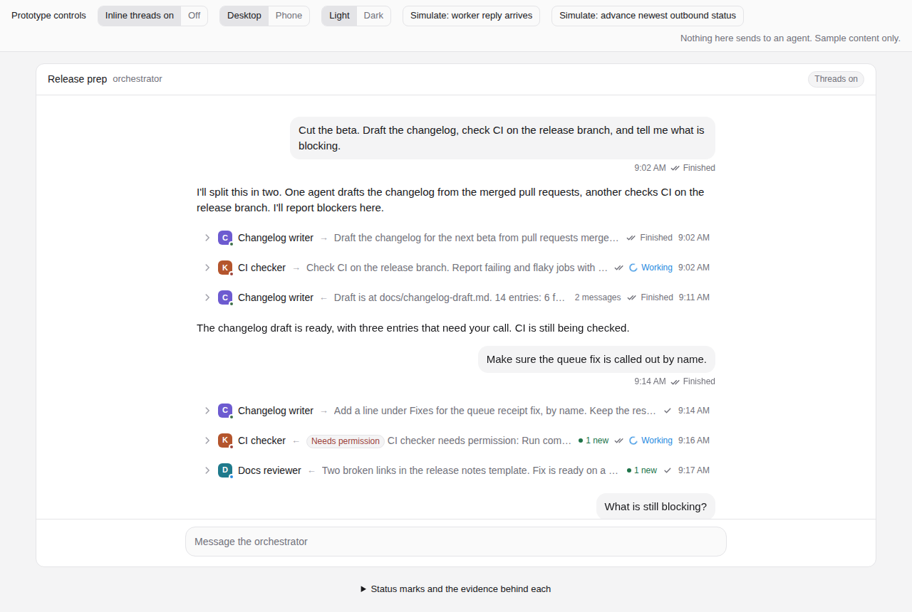
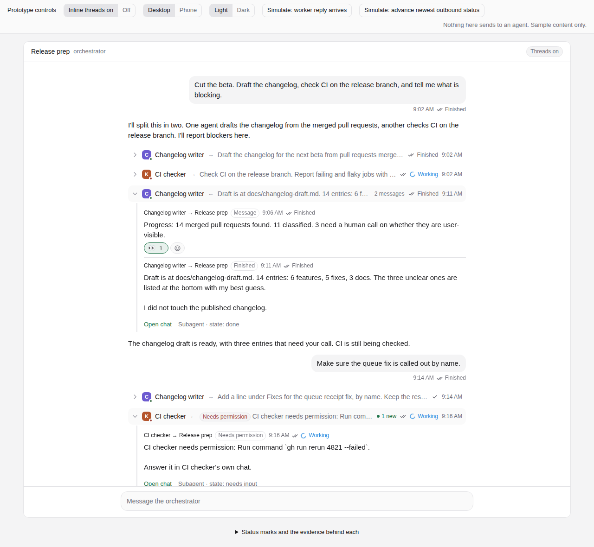
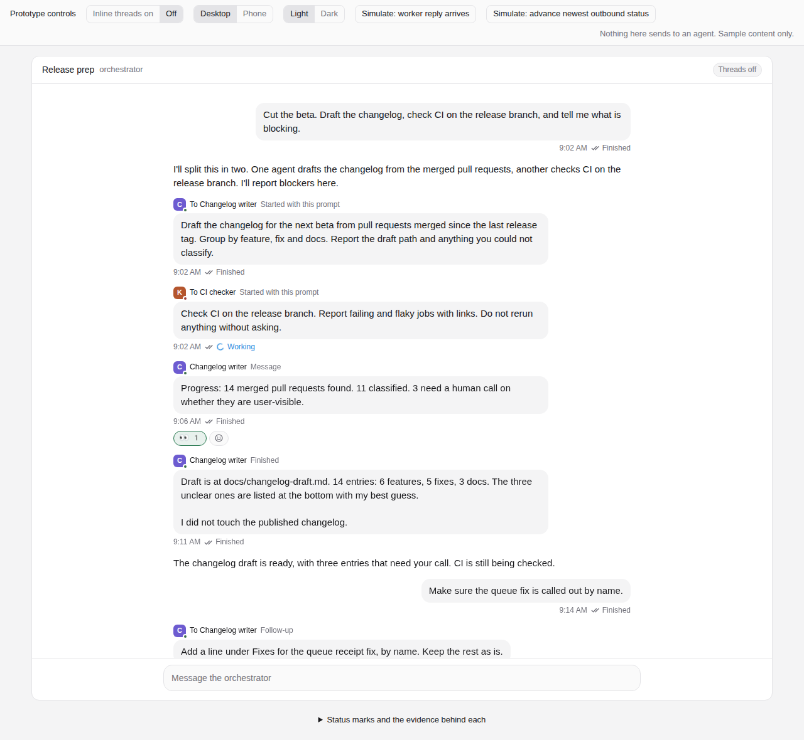
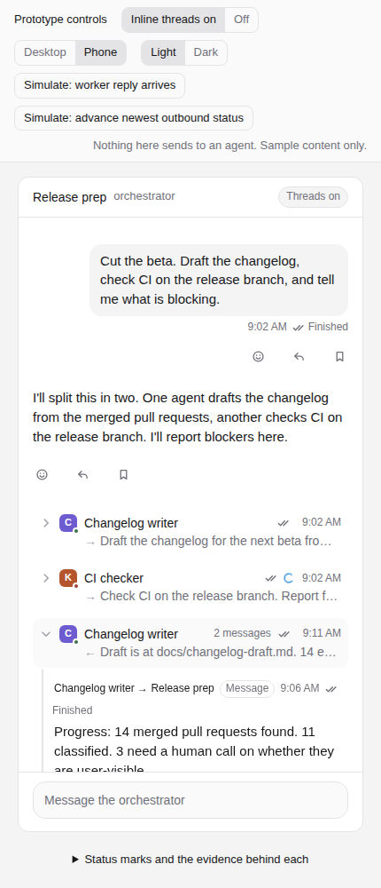
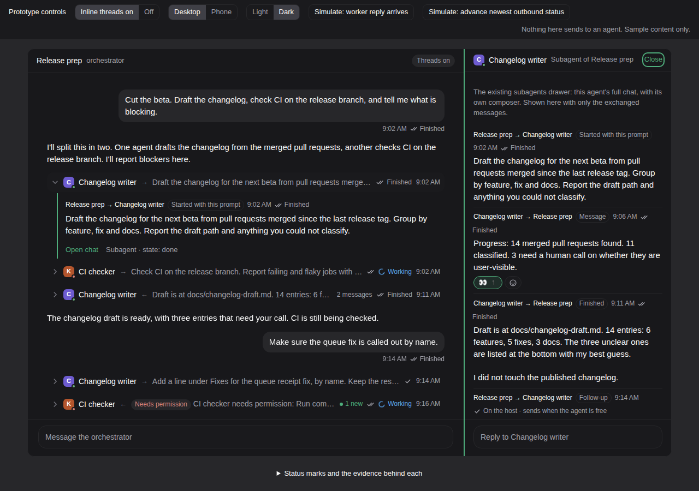

# Inline threads, message statuses and reactions

**Status (2026-11-14):** Design recommended, nothing built. Spec:
[inline-threads-design-2026-11-14.md](inline-threads-design-2026-11-14.md).
[Interactive prototype](inline-threads/prototype.html) (open the file in a browser). Code
references are to fork `main` at `9ae1aafe2`.

## The question

In an orchestrator chat, messages to and from worker agents fill the transcript. Jacob asked
for three things:

1. Slack-style collapsible threads, so worker replies stay in the chat, mostly inline. On by
   default, with a way to turn it off.
2. A status on every message he sends, and probably on messages received.
3. Slack-style emoji reactions on messages.

He remembered the threads part as planned for a while. It was; see History.

## History

- **2026-10-10 / 11: threads view for orchestrators (bead `pspin-plx`, under the Orchestration
  UX epic `pspin-787`).** From a request in an orchestrator chat. One orchestrator conversation
  as the main chat, its threads listed beside it with state, a condensed blocker or report, and
  unread; select one to read and reply; threads persist and can be steered while away.
  Reference: Claude Projects and Managed Agents session threads. Filed as a design follow-up
  and not built as such. Four questions were left open: whether sessions an orchestrator only
  routed work to count as threads, whether the list replaces the subagents pill, same-host or
  cross-host, and what the shared-memory analog is.
- **2026-10-10: Subagents drawer and session side panel (PR #79, `pspin-c64`).** Delivered the
  "listed beside it, read and reply" part of `pspin-plx` for subagents.
  [Agent lifecycle](../agent-lifecycle.md#the-subagents-drawer).
- **2026-10-11, merged 2026-10-25: Reply in thread (PR #84, `pspin-w4e`).** A side session about
  one assistant reply, linked by `paseo.thread-parent` / `paseo.thread-anchor`, with an **N
  replies** chip. [Threaded replies](../threaded-replies.md).
- **2026-10-22: delivery marks and the durable send outbox (PR #94, `pspin-86u`).** Clock,
  check, double check and alert on the user's own messages.
  [Queue mirroring](../queue-mirroring.md#delivery-marks). Also `paseo queue ls` (PR #95) and
  receipt recovery (PR #161, PR #194).
- **2026-10-24: how the conversation structures fit together.** Decided with Jacob: one message
  menu with Save to Stream, Reply, Reply in thread and Fork. "Collapsible sections are the read
  view of threads, not a separate feature": no manual folding of arbitrary ranges. "Fold into
  thread" (move a detour out of the main chat after the fact) was proposed and not built.
- **2026-10-26 / 27: first-class threads plan (bead `pspin-plx.1`).** A plan and mockup with an
  Opus second opinion: a Threads navigator in the session side panel, ancestor breadcrumbs,
  Reply in thread on user messages, nested threads verified end to end. It says to keep chat
  lineage (threads) apart from agent ownership (subagents). Not built. It does not cover
  threads in the transcript, statuses or reactions.
- **2026-10-31: quote Reply and Save to Stream (PR #153, `pspin-hn3`).**
- **2026-10-31, another app:** a status line on each sent message (sending, queued, working
  with a timer, done or stopped, and a warning when delivery is uncertain) was built for a
  different chat client. It is the precedent for the status wording here.
- **Sender attribution (PR #164, `pspin-575`).** Every user message records `human`,
  `schedule` or `agent:<id>`. [Agent lifecycle](../agent-lifecycle.md#who-sent-it).
- **Reactions.** No earlier plan, bead, PR or code was found.

## Recommendation (2026-11-14)

A recommendation, not yet a decision. Details and reasons are in the spec.

- **One primitive, the thread row.** A message to or from another agent collapses to one line
  in the chat: who, direction, preview, count, new, status, time. It expands in place. **Open
  chat** shows the other agent's full chat in the existing subagents drawer.
- **Rows stay in time order.** Adjacent messages with the same agent merge. Replies are not
  moved up under the first message, because an agent's turns are caused by what arrived before
  them. The orchestrator's own replies to the user are never folded, and neither are the
  prompts of the agent that drives a chat.
- **Evidence only.** A row is a thread row only when the daemon recorded both ends of the
  message. No guessing from text.
- **A small durable record, the exchange log.** The timeline is runtime memory and is rebuilt
  from provider history after a restart, without senders. The daemon keeps a bounded per-agent
  list of agent-to-agent messages, and thread rows are drawn from it.
- **Default on, one setting.** Settings → Chat → Group agent messages into threads. Per device.
- **Two status facts, kept apart.** The existing delivery marks stay as they are. A separate
  turn state (Working, Finished, Stopped, failed) says what the recipient's agent did. A check
  never turns into work, Finished means the turn ended and not that the task is done, and there
  are no read receipts.
- **Reactions are annotations.** Not delivered to agents, not readable by agents, never a
  status, approval or completion. Keyed by message id, never by timeline position.

What the code turned up:

- The app drops the `sender` the daemon sends (`packages/app/src/types/stream.ts:92`).
- `paseo send` run by an agent is recorded as `human`
  (`packages/server/src/server/session.ts:9298`), so a CLI-driven orchestrator chat cannot tell
  worker reports from the user's messages. Phase 0 fixes this.
- Finish notifications are kept out of the transcript. An idle parent gets no row at all
  (`packages/server/src/server/agent/agent-prompt.ts:611`), so it starts a turn with no visible
  cause.
- Timeline rows, their senders, turn ids and cursors do not survive a daemon restart.

## Phases

| Phase | What                                                                | Touches               |
| ----- | ------------------------------------------------------------------- | --------------------- |
| 0     | Record the calling agent as sender for `paseo send`                 | Protocol, daemon, CLI |
| 1     | Exchange log, thread rows, the setting, Working on your own bubbles | Daemon, app           |
| 2     | Turn outcomes (Finished, Stopped, failed) with turn records         | Daemon, app           |
| 3     | Reactions; 3b agent-added reactions                                 | Daemon, app           |
| 4     | Reply-thread chip as a thread row; Threads navigator                | App                   |

Phases 0 and 1 are the smallest useful set. Phase 0 has its own PR.

## Open questions

The spec takes four defaults that Jacob may want to change (spec section 12): agents may add
reactions but never read them; the turn word is "Finished", not "Done"; a permission request
badges its row without expanding it; the setting is per device.

The four `pspin-plx` questions have proposed answers in the same section. The wording of
`pspin-plx` above is as summarized by later sessions; the bead itself was not read.

## Screenshots

From the prototype, sample content only. It shows the end state through Phase 3.

| Collapsed                                          | Expanded                                         |
| -------------------------------------------------- | ------------------------------------------------ |
|  |  |

| Setting off                            | Phone                                       | Open thread (dark)                        |
| -------------------------------------- | ------------------------------------------- | ----------------------------------------- |
|  |  |  |
